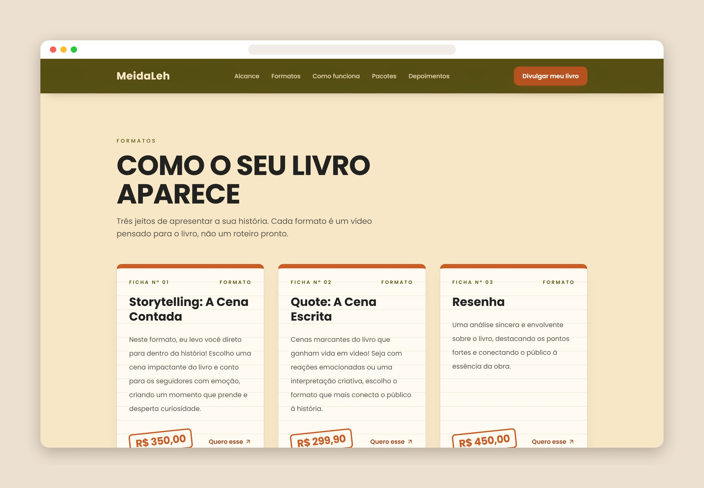
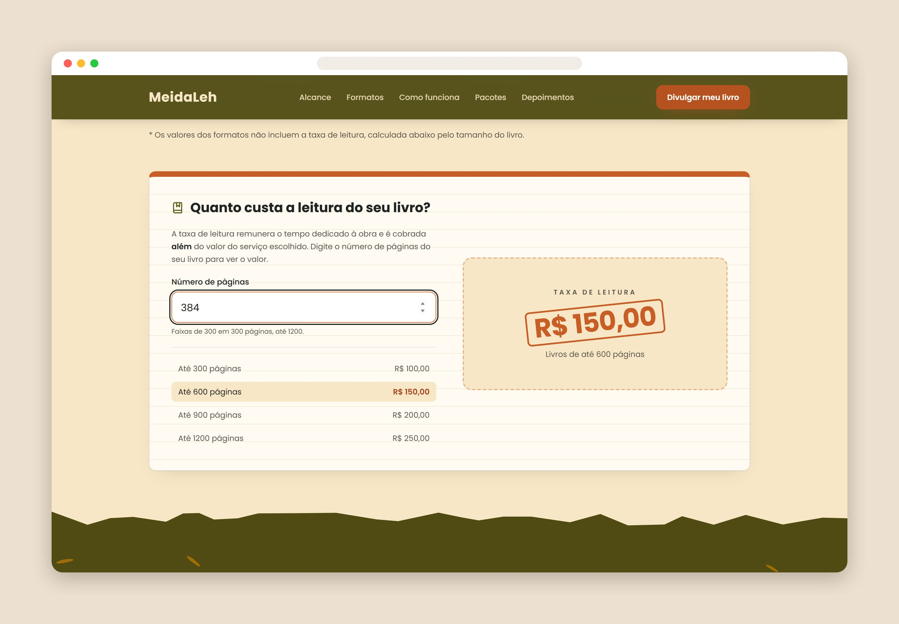
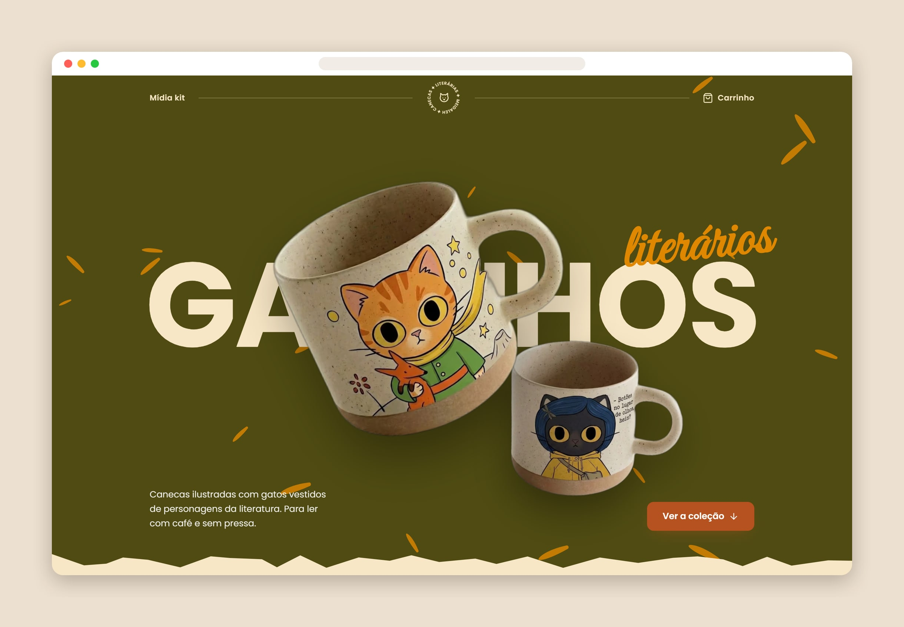
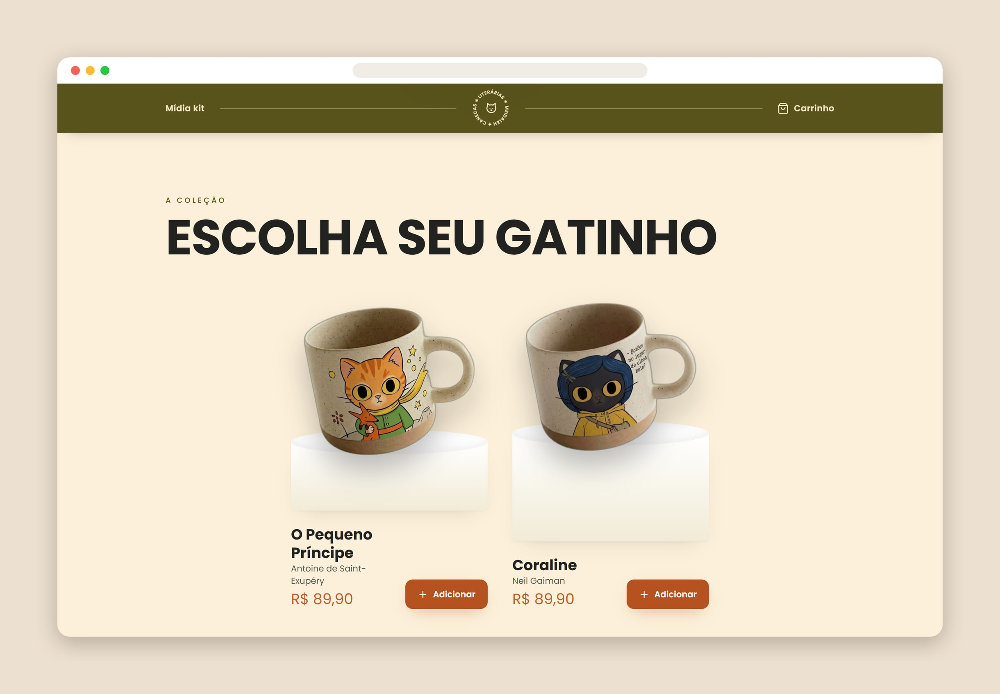
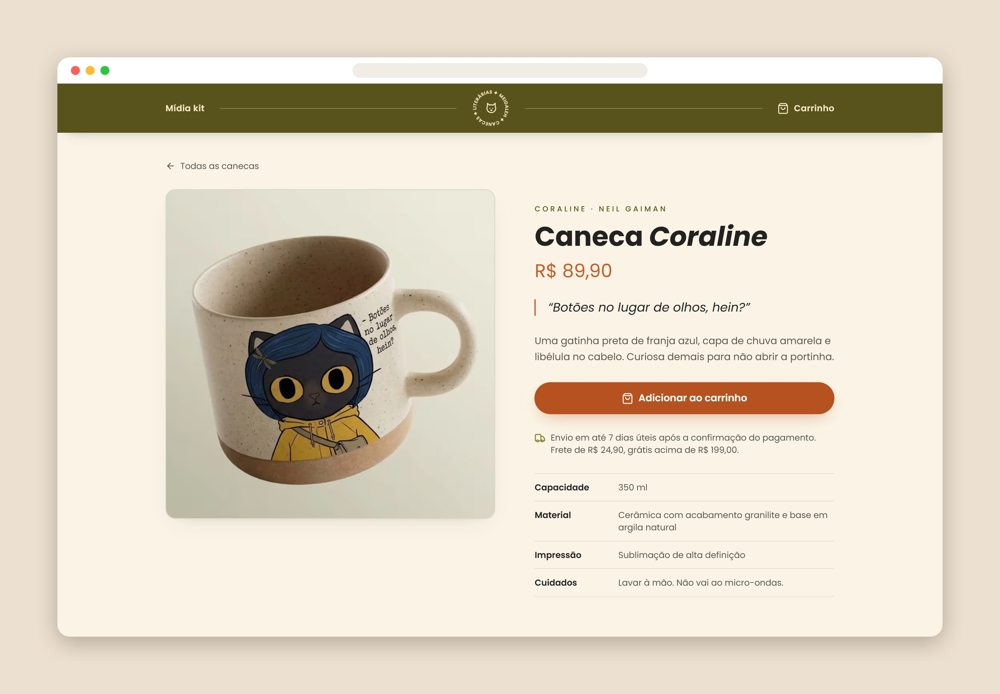
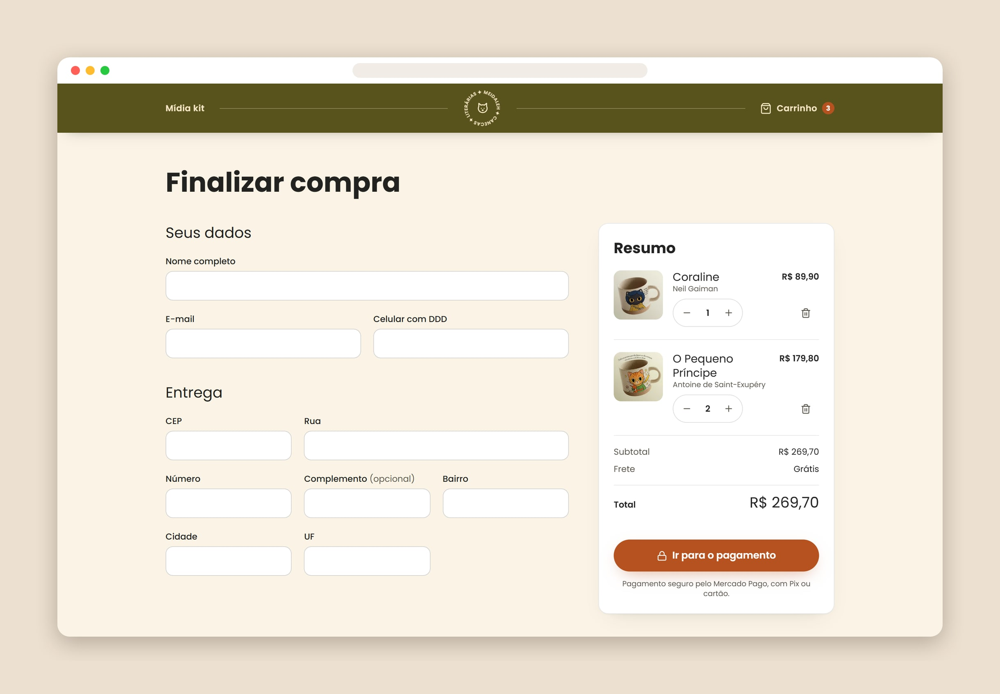
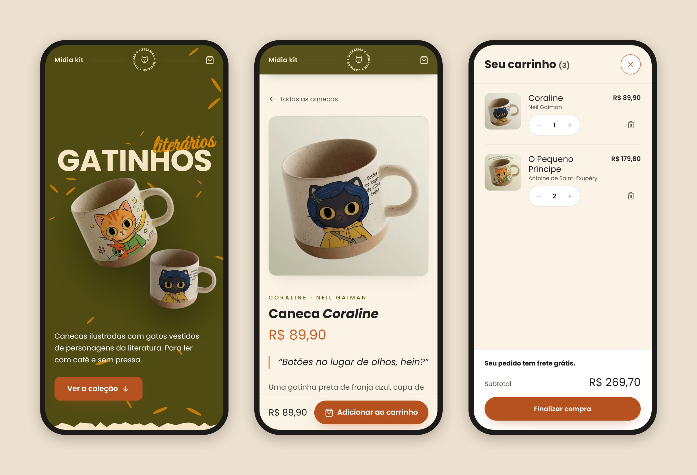
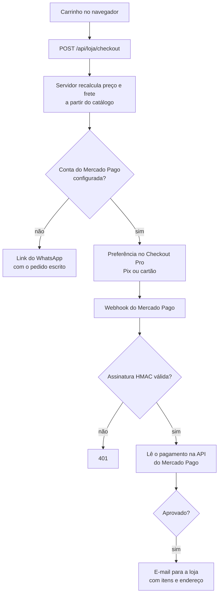

# MeidaLeh: mídia kit e loja de uma criadora literária

A MeidaLeh é a Lethicia Almeida, criadora de conteúdo sobre livros no TikTok, no Instagram e no YouTube. Fiz para ela duas coisas no mesmo site:

- o **mídia kit 2026**, que fala com escritoras que querem divulgar um livro e já mostra preço, formato e taxa de leitura;
- a **loja de canecas** "gatinhos literários", com carrinho, checkout e pagamento pelo Mercado Pago.

> Repositório vitrine. O código é do projeto da cliente e fica privado; aqui ficam as telas, as decisões e o funcionamento.

## Situação em 23/11/2026

| | |
|---|---|
| Mídia kit 2026 | **No ar** em [meidaleh.vercel.app](https://meidaleh.vercel.app). O domínio próprio ainda serve a versão de 2025, feita em outra ferramenta |
| Loja de canecas | **Pronta**, desligada por uma variável de ambiente até a Leh confirmar preço, frete e dados da caneca |
| Pagamento pelo Mercado Pago | **Pronto no código**, esperando a conta. Sem ela, o checkout manda o pedido pelo WhatsApp |

Os prints foram tirados localmente da versão atual, com a loja ligada só na minha máquina. Os números de alcance são os que estão no site dela. No checkout, o formulário aparece vazio, e o carrinho tem itens de teste.

## O mídia kit

Quem lê um mídia kit de influenciadora literária quase sempre é uma autora independente com uma pergunta só: quanto custa e o que eu recebo. O site responde isso em uma página, nesta ordem: alcance, formatos, taxa de leitura, como funciona, pacotes, depoimentos.

**Formatos com preço na cara.** Cada formato (Storytelling, Quote, Resenha) é uma ficha de biblioteca com o valor no rodapé. Não tem "sob consulta" onde dá para dizer o número.

**Taxa de leitura calculada.** A Leh lê o livro inteiro antes de gravar, e isso é cobrado à parte, por faixa de páginas. A autora digita o número de páginas e vê o valor; a faixa certa fica marcada na tabela ao lado. O resultado é anunciado para leitores de tela.

**Pacotes que somam sozinhos.** O card mostra o "a partir de". Ao abrir, a autora escolhe a faixa de páginas e vê o valor exato, e o botão já abre o WhatsApp com pacote, faixa e valor escritos. A tabela dos pacotes é derivada da tabela da taxa de leitura no código, então as duas não saem de sincronia quando um preço muda.

No celular, o strip de métricas aparece na primeira tela, os alvos de toque têm pelo menos 48 px e o menu fecha no Esc.

## A loja

Coleção de canecas com gatos vestidos de personagens de livros. A vitrine conta a coleção como história, com a caneca principal atravessando as seções conforme a rolagem.

### Como um pedido acontece

- **O navegador não define preço.** O carrinho manda só produto e quantidade. O servidor monta o pedido de novo a partir do catálogo, com o frete, e é esse valor que vai para o Mercado Pago.
- **A loja vende antes de ter conta.** Sem a chave do Mercado Pago, o mesmo checkout gera uma mensagem de WhatsApp com itens, total e endereço. Ligar o pagamento é só preencher variáveis de ambiente.
- **O webhook não acredita no corpo da requisição.** Primeiro confere o `x-signature` com HMAC-SHA256 e comparação em tempo constante. Depois busca o pagamento na API do Mercado Pago pelo ID e só avisa a loja quando ele está aprovado.
- **Fechada sem apagar nada.** Uma variável de ambiente desliga a loja inteira: as páginas respondem 404, as rotas de API recusam pedidos e o link some do menu.

## Design

A direção veio do próprio universo da Leh: anos 70, quarto com tapeçaria de sol, pôsteres e letreiro a pincel. A paleta saiu da loja antiga e do Linktree dela: creme, terracota, laranja e oliva. Todos os pares de texto e fundo passam no contraste AA. Nos pares que não passavam, o terracota fica só em texto grande, e os botões usam um tom mais escuro.

O movimento usa só `transform` e `opacity` e desliga inteiro com `prefers-reduced-motion`. Nesse caso, os contadores mostram o valor final direto, e a caneca da loja fica parada.

## Limites, por escrito

- Não há banco de dados. O registro do pedido fica no e-mail e no painel do Mercado Pago. Como o Mercado Pago reenvia notificações, o mesmo pedido pode chegar em mais de um e-mail, com o ID no assunto.
- O frete é fixo para o Brasil inteiro. Cálculo por CEP depende de integrar o Melhor Envio.
- Não há controle de estoque. Produto esgotado é marcado à mão no catálogo.
- Os inscritos do YouTube podem vir da API, atualizados no máximo uma vez por hora. Instagram e TikTok são manuais, porque nenhuma das duas redes entrega esse número de forma estável.

## Stack

Next.js 15 (App Router) · React 19 · TypeScript · Tailwind CSS · Framer Motion · Mercado Pago Checkout Pro · Nodemailer · Vercel

## Outros cases

- [Kamo](https://github.com/domingos-engineering/kamo-showcase): meu SaaS de IA no WhatsApp para concessionárias.
- [E-commerce da 4Life Nutrition](https://github.com/domingos-engineering/4life-nutrition-showcase): loja com código próprio, do checkout à nota fiscal.
- [4Life Creators](https://github.com/domingos-engineering/4life-creators-showcase): plataforma de influenciadores com cupom, campanhas e comissão.

---

Douglas Domingos · [github.com/domingos-engineering](https://github.com/domingos-engineering) · [LinkedIn](https://www.linkedin.com/in/douglas-c-domingos/)
